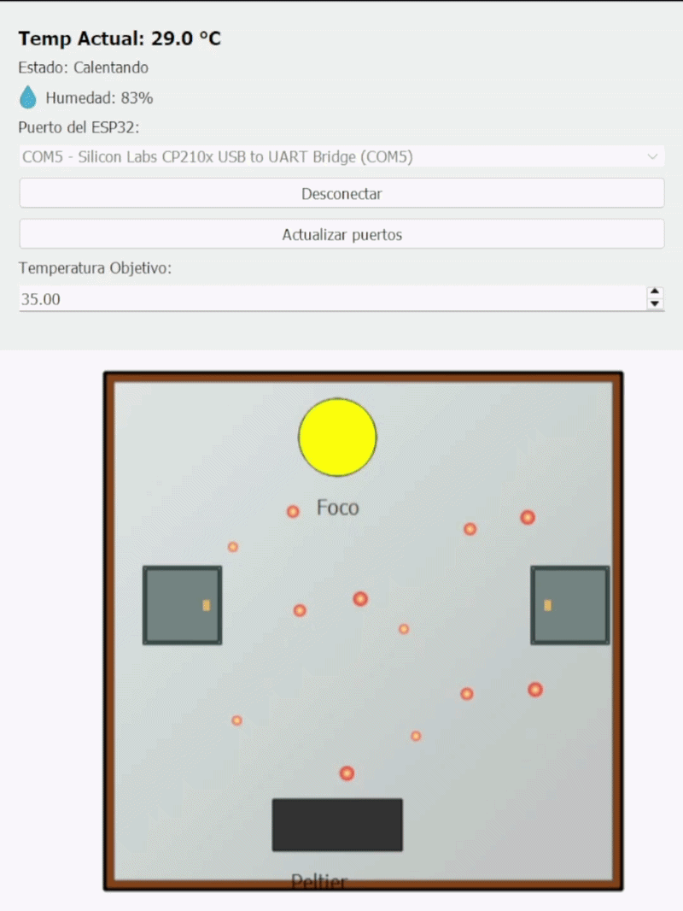

# 🌡️ Proyecto 04: Caja Térmica Inteligente con Sistema de Purga

## 📋 Objetivo
Diseñar e implementar una cámara térmica controlada por un microcontrolador ESP32, capaz de mantener una temperatura dentro de un rango configurable de 20 a 50 °C mediante un sistema de calefacción (foco) y refrigeración (módulo Peltier). La purga se solicita manualmente desde la interfaz.

---

## ⚙️ Lógica de Control y Funcionamiento

El firmware implementa un control robusto basado en tres pilares fundamentales:

1. **Ciclo térmico continuo:**
   Al pulsar **Iniciar ciclo térmico**, el usuario elige si quiere alcanzar primero la temperatura mínima o la máxima. El ESP32 llega a ese límite y alterna entre ambos hasta recibir **Detener todo**. Si la temperatura empieza fuera del rango, primero llega al límite elegido. Los límites no se pueden editar durante el ciclo.
2. **Purga automática y manual:**
   Al alcanzar el límite máximo durante el ciclo, el ESP32 inicia una purga antes de enfriar y no repite la purga 2.5 °C más abajo en ese tramo. Si el ciclo comienza enfriando, conserva la purga cuando la temperatura cae 2.5 °C por debajo del máximo. La interfaz también recomienda purgar cuando el punto de rocío calculado alcanza o supera la temperatura mínima configurada; esta recomendación no activa la purga. El usuario puede solicitarla manualmente durante el ciclo: el control térmico se pausa mientras los ventiladores extraen aire durante 20 segundos y luego continúa hacia el mismo límite.
   - Abre las tapas superiores mediante servomotores (SG90).
   - Activa los ventiladores de extracción para renovar el aire estancado.
   - Cierra las tapas al terminar los 20 segundos de extracción y reanuda el ciclo térmico.
3. **Protecciones de seguridad:**
   Una lectura de temperatura DHT11 inválida o fuera de su rango de operación de 0 a 50 °C apaga foco, Peltier y ventiladores, cierra las tapas y reporta `STATUS,ERROR`. El control se reanuda automáticamente cuando vuelve una lectura válida. Si falla solo la humedad, se conserva el control por temperatura y se desactiva la lectura de punto de rocío.
   El foco tiene un máximo de 10 minutos continuos seguido de 1 minuto de descanso; la Peltier tiene un máximo de 15 minutos seguido de 2 minutos de descanso. Si se pierden comandos seriales durante 30 segundos, se conserva el rango configurado y el control térmico autónomo sigue funcionando.
   Los mensajes detallados de cambios de fase, decisiones de control y protecciones se habilitan compilando con `DEBUG_MODE` definido.

---

## 🛠️ Hardware y Diagrama de Pines

| Componente | Pin ESP32 | Función / Nota |
| :--- | :---: | :--- |
| **Sensor DHT11** | GPIO 15 | Lectura digital de temperatura y humedad. Alimentar a 3.3 V. |
| **Teclado matricial 4×4** | GPIO 13, 14, 26, 27 / 25, 33, 32, 4 | Filas / columnas. |
| **Foco 60W** | Dimmer mecánico posicionado por servo | El servo recibe su señal de control por GPIO 21; el foco no usa el relé. |
| **Módulo Peltier** | GPIO 19 | Conmutado por el relé; GPIO 19 queda como su salida de control. |
| **Ventiladores 12V** | GPIO 18 | Circulación de aire y apoyo en la purga. |
| **Servo Tapa 1** | GPIO 22 | Apertura de compuerta de ventilación izquierda. |
| **Servo Tapa 2** | GPIO 23 | Apertura de compuerta de ventilación derecha. |
| **Servo del dimmer** | GPIO 21 | Ajusta mecánicamente el dimmer del foco; recorrido configurable en el firmware, inicialmente 0° apagado y 100° potencia máxima. |

> ⚠️ **Nota de Seguridad:** El foco y el módulo Peltier nunca se activan simultáneamente en el firmware (`escribirSalidas`) para evitar cortocircuitos o daños a la fuente de alimentación. El relé se conserva para la Peltier; el foco depende del servo y del apagado real del dimmer en 0°.
>
> El firmware mantiene los límites de control dentro de 20–50 °C (máximo recomendado del DHT11) y garantiza al menos 2 °C de diferencia.
>
> En un DHT11 sin módulo, conecta una resistencia pull-up de 4.7–10 kΩ entre DATA y 3.3 V. Comparte GND entre sensor y ESP32; no alimentes DATA con 5 V. GPIO 15 también es un pin de configuración de arranque del ESP32: confirma que la placa arranque normalmente con el sensor conectado. El DHT11 tiene resolución de 1 °C y actualiza cada 2 segundos, por lo que la telemetría de 250 ms puede repetir el último valor.
>
> El servo del dimmer mueve mecánicamente el mando de un dimmer aislado. Recibe su posición objetivo desde el PID y avanza hasta 5° cada 20 ms. Los valores `ANGULO_DIMER_MINIMO` y `ANGULO_DIMER_MAXIMO`, visibles al inicio del sketch, son ajustables; se configuran inicialmente en 0° (apagado) y 100° (potencia máxima). Aumenta el máximo gradualmente y sin forzar el tope mecánico. Cuando el control se detiene o hay error de sensor, el servo vuelve a 0°. Alimenta los servos con una fuente adecuada para ellos y comparte GND con el ESP32. El ángulo reportado es el comandado, no una medición de posición real.

---

## 💻 Interfaz Gráfica y Simulación (PyQt5)

Se desarrolló una aplicación de escritorio en Python utilizando **PyQt5** que actúa como un "Gemelo Digital" del sistema físico.

**Características de la simulación:**
- **Visualización en Tiempo Real:** Representación gráfica de la caja, con animación de los ventiladores girando y las tapas abriéndose/cerrándose suavemente.
- **Partículas de Flujo:** Animación de partículas que simulan el flujo de aire caliente (rojo) o frío (azul) dependiendo del modo térmico.
- **Cambio de Ambiente:** El color de fondo de la cámara cambia gradualmente (gradiente) reflejando la temperatura actual.
- **Ciclo térmico:** Permite elegir el primer límite, muestra avisos si la temperatura está fuera del rango y ofrece **Detener todo**.
- **Purga:** Se activa automáticamente al alcanzar la máxima, antes de iniciar el enfriamiento, y puede solicitarse manualmente; al concluir, el ciclo continúa.
- **Aviso de condensación:** Calculado con las lecturas de temperatura y humedad del DHT11.
- **Navegación por teclado matricial:** Con la interfaz conectada, inicia en modo A; 2/4/6/8 mueven el foco, 1/3 ajustan el valor enfocado en ±0.5 y # selecciona o abre un menú. En controles numéricos, # entra al modo B; dígitos y * escriben el valor, y # confirma y vuelve a A. B activa entrada numérica y A regresa a navegación. C inicia el ciclo hacia la mínima y D detiene todo. Mouse y teclado de la computadora siguen disponibles; sin interfaz conectada se conserva el control local del ESP32.
- **Prueba de tapas y ventiladores:** Mueve los servos de tapas en GPIO 22/23 y solicita HIGH en GPIO 18; no mueve el servo dimmer de GPIO 21.
- **Control PID:** Control en lazo cerrado con banda muerta de ±1 °C y sintonización dinámica de Kp, Ki y Kd desde la interfaz. La salida PID regula el foco con el servo del dimmer; la Peltier conserva el control por ventanas de 60 segundos.
- **Prueba del dimmer:** El botón independiente mueve el servo a 50° (50% del recorrido configurado) durante un segundo y luego vuelve a 0°. Solo está disponible con lectura válida del DHT11 y cuando el ciclo/control térmico está detenido; no sustituye una comprobación física segura del foco y el dimmer.
- **Gráfica en tiempo real:** Visualización de la respuesta térmica y del Setpoint mediante gráficas animadas con pyqtgraph.
- **Comunicación Serial:** Selecciona el puerto COM del ESP32 y pulsa **Conectar** (115200 baudios); la aplicación no inicia el control térmico automáticamente. Recibe `ACK,SETRANGE` al editar el rango y `STATUS` cada 250 ms. El firmware debe ser compatible con el protocolo de ciclo para habilitar los botones de inicio y detención.

La aplicación de escritorio `Temperatura.py` conserva sus dependencias PyQt; instala `PyQt5`, `pyqtgraph` y `pyserial` por separado. `requirements.txt` queda destinado a la aplicación Flet para Android.

## 📱 Aplicación móvil Flet (Android)

`TemperaturaAPK.py` ofrece la misma configuración térmica y comandos principales en una interfaz adaptable a móvil. La conexión Wi-Fi usa TCP en el puerto **8888**; también puede usar Serial USB en Windows/PC cuando PySerial esté instalado. El teclado matricial mantiene `KEYPAD_UI,1` con heartbeat cada segundo y procesa las teclas físicas y virtuales con el mismo mapeo. La gráfica nativa se dibuja con `flet.canvas` y muestra temperatura y setpoint en el tiempo.

Antes de cargar el firmware, configura `WIFI_SSID` y `WIFI_PASSWORD` al inicio de `codigo/ESP32CodeTemperatura/ESP32CodeTemperatura.ino`. El ESP32 se conecta a esa red como cliente; consulta por Serial la trama `INFO,WIFI,READY,<IP>` o revisa los clientes del router para encontrar su dirección. El teléfono y el ESP32 deben estar en la misma red local. No expongas el puerto TCP 8888 directamente a Internet.

Instala el entorno de compilación Android (JDK 17 y Android SDK; Flet puede instalarlos al primer build) y ejecuta desde esta carpeta:

```bash
pip install -r requirements.txt
flet build apk --module-name TemperaturaAPK --android-permissions android.permission.INTERNET=true
```

La dependencia única de `requirements.txt` es `flet==1.1.4`; PySerial se importa opcionalmente y no se incluye en el APK. Flet 1.1.4 no expone `ft.LineChart`, por lo que la gráfica usa los controles Canvas incluidos en Flet, sin instalar un paquete de charts.

##  Ver simulación
  

> 🌐 **Prueba tu mismo los entornos:** Todos los proyectos cuentan con un [Gemelo Digital para interactuar ](https://coe-embedded-lab.streamlit.app).

---

## 🔄 Protocolo de Comunicación Serial y Wi-Fi

La interfaz y el ESP32 intercambian texto plano estructurado, terminado en `\n`, tanto por Serial USB a 115200 baudios como por TCP en el puerto 8888:

| Dirección | Comando / Formato | Descripción |
| :--- | :--- | :--- |
| **PC → ESP32** | `SETRANGE,28.0,35.0` | Establece los límites de temperatura (ambos entre 20.0 y 50.0 °C y separados por al menos 2.0 °C). |
| **PC → ESP32** | `CYCLE,MIN` / `CYCLE,MAX` | Inicia el ciclo con el límite indicado como primera meta. |
| **PC → ESP32** | `STOP` | Detiene el ciclo y apaga foco, Peltier, ventiladores y compuertas. |
| **PC → ESP32** | `PURGE` | Solicita manualmente una purga; pausa el control térmico y lo reanuda al terminar. |
| **PC → ESP32** | `TEMP_TARGET:XX` | Activa el control PID con el objetivo indicado entre 20 y 50 °C. |
| **PC → ESP32** | `PID_TUNE,Kp,Ki,Kd` | Actualiza los parámetros PID; cada parámetro debe estar entre 0 y 10. |
| **PC → ESP32** | `KEYPAD_UI,1` / `KEYPAD_UI,0` | Activa el envío de teclas matriciales a la interfaz; se mantiene con una señal cada segundo y vuelve al control local si se pierde durante 5 segundos. |
| **ESP32 → interfaz** | `INFO,WIFI,READY,<IP>` | Indica por Serial que el servidor TCP está listo y muestra la IP del ESP32. |
| **ESP32 → PC** | `KEYPAD_KEY,<tecla>` | Entrega una tecla física al navegador de la interfaz cuando está activo el modo UI. |
| **PC → ESP32** | `DIMMER_TEST` | Prueba el dimmer a 50% por un segundo y retorna el servo a 0°; requiere sensor válido y control detenido. |
| **ESP32 → PC** | `ACK,DIMMER_TEST,STARTED` / `ACK,DIMMER_TEST,DONE` | Indica el inicio y la finalización de la prueba automática. |
| **ESP32 → PC** | `ERR,DIMMER_TEST,SENSOR` / `ERR,DIMMER_TEST,BUSY` | Rechaza la prueba si el DHT11 no es válido o el sistema no está detenido. |
| **ESP32 → PC** | `TEMP_CURRENT:XX` | Lectura de temperatura DHT11 enviada cada 2 segundos para la gráfica en tiempo real. |
| **ESP32 → PC** | `STATUS,temp,foco,peltier,fans,tapas,FASE,humedad,tempMin,tempMax,cicloActivo,potenciaFoco,anguloServo` | Telemetría del ciclo, potencia solicitada del foco (0–100 %) y ángulo comandado (configurado inicialmente entre 0° y 100°). |
| **ESP32 → PC** | `STATUS,ERROR,0,0,0,0,SENSOR_ERROR,0.0,28.0,35.0,cicloActivo,0,anguloServo` | Alerta crítica por fallo de sensor; la potencia se lleva a 0 y el servo recibe la orden de 0°. |
| **ESP32 → PC** | `ACK,SETRANGE,tempMin,tempMax` | Actualización inmediata de los límites de temperatura. |
| **ESP32 → PC** | `WARN,DEWPOINT,RISK,puntoRocio,tempMin` / `WARN,DEWPOINT,CLEAR` | Avisos calculados con las lecturas del DHT11. |

---

## 🚀 Instrucciones de Ejecución

### 1. Cargar el Firmware
- Abre `codigo/ESP32CodeTemperatura/ESP32CodeTemperatura.ino` en Arduino IDE.
- Instala las librerías `ESP32Servo`, `DHT sensor library` y `PID_v1`.
- Selecciona la placa "ESP32 Dev Module" y carga el código.
- Configura `WIFI_SSID` y `WIFI_PASSWORD` antes de cargar si usarás la conexión Wi-Fi.

### 2. Ejecutar las interfaces
- Para la aplicación de escritorio PyQt:
  ```bash
  pip install PyQt5 pyqtgraph pyserial
  python Temperatura.py
  ```
- Para compilar la aplicación Flet a APK, instala `requirements.txt` y sigue el comando de la sección **Aplicación móvil Flet (Android)**.

---

## ANEXOS

### A. Alcance y datos de referencia

La cámara se modela como un recinto de triplay de $0.30 \times 0.30 \times
0.30\ \mathrm{m}$, con volumen nominal

$$
V = 0.30^3 = 0.027\ \mathrm{m^3} = 27\ \mathrm{L}.
$$

El control inicial opera entre $28$ y $35\ ^\circ\mathrm{C}$ y puede
configurarse entre $20$ y $60\ ^\circ\mathrm{C}$. Los
ventiladores interiores mezclan el aire; durante la purga, las tapas accionadas
por servos permiten la salida de aire y su reemplazo por aire del entorno.
Para renovar aire hace falta una trayectoria de entrada y otra de salida: la
recirculación interna por sí sola no reduce la concentración de vapor ni
renueva el volumen de la cámara.

Los cálculos siguientes son estimaciones de ingeniería, no mediciones de la
cámara. En particular, el caudal real depende del ventilador, las aberturas,
las fugas, las rejillas y las pérdidas de presión. Debe medirse en el montaje.

### B. Presión de vapor y punto de rocío

#### B.1 Presión de saturación

La forma integrada de Clausius–Clapeyron, suponiendo calor latente de
vaporización aproximadamente constante, es

$$
\ln\left(\frac{P_s}{P_0}\right)
= \frac{L_v}{R_v}\left(\frac{1}{T_0}-\frac{1}{T}\right),
\qquad
P_s(T)=P_0\exp\left[
\frac{L_v}{R_v}\left(\frac{1}{T_0}-\frac{1}{T}\right)
\right].
$$

$T$ y $T_0$ se expresan en kelvin, $P_s$ y $P_0$ en las mismas unidades de
presión, $L_v$ es el calor latente de vaporización y $R_v$ la constante
específica del vapor de agua. Esta relación física describe la variación de la
presión de saturación; en el intervalo de temperaturas de la cámara es cómodo
usar la aproximación de Magnus:

$$
P_s(T) = 611.2\,
\exp\left(\frac{17.67\,T}{T+243.5}\right)\ \mathrm{Pa},
$$

donde $T$ está en grados Celsius. La presión parcial real del vapor se estima
con la humedad relativa $\phi$ expresada como fracción:

$$
P_v = \phi P_s(T),\qquad 0\leq\phi\leq 1.
$$

Valores aproximados de presión de saturación:

| Temperatura | $P_s$ |
| ---: | ---: |
| $30\ ^\circ\mathrm{C}$ | $4.25\ \mathrm{kPa}$ |
| $35\ ^\circ\mathrm{C}$ | $5.63\ \mathrm{kPa}$ |
| $40\ ^\circ\mathrm{C}$ | $7.40\ \mathrm{kPa}$ |

#### B.2 Temperatura de rocío

Una aproximación de Magnus para el punto de rocío es

$$
\gamma(T,\phi)=\ln(\phi)+\frac{17.67T}{243.5+T},
\qquad
T_{rocío}=\frac{243.5\,\gamma}{17.67-\gamma}.
$$

Con aire a $35\ ^\circ\mathrm{C}$ y humedad relativa del $90\%$,
$T_{rocío}\approx33.1\ ^\circ\mathrm{C}$. Por tanto, cualquier superficie
interior por debajo de aproximadamente $33.1\ ^\circ\mathrm{C}$ puede
condensar agua. En el rango del proyecto, una superficie a $28\ ^\circ\mathrm{C}$
presenta riesgo bajo esas condiciones, aunque el aire esté dentro del rango
térmico previsto. El punto de rocío depende de la temperatura y humedad del
aire; la condensación ocurre cuando $T_{superficie}\leq T_{rocío}$. Como no
hay un sensor de superficie instalado, el firmware aproxima la superficie fría
con la temperatura mínima configurada y avisa cuando
$T_{rocío}\geq T_{mínima}$. Es una estimación, no una medición directa de
condensación.

#### B.3 Estimación de tasa de condensación

Una estimación de transferencia de masa desde el aire hacia una superficie fría
es

$$
\dot m'' =
h_m\max\left[0,\rho_{v,aire}-\rho_{v,sat}(T_s)\right],
\qquad
\dot m=A_s\dot m'',
$$

con

$$
\rho_v=\frac{P_v}{R_v T_K},\qquad
\rho_{v,sat}(T_s)=
\frac{P_s(T_s)}{R_v(T_s+273.15)}.
$$

$\dot m''$ es el flujo de condensado en $\mathrm{kg\,m^{-2}\,s^{-1}}$,
$\dot m$ la masa condensada por segundo, $A_s$ el área mojada,
$h_m$ el coeficiente convectivo de transferencia de masa en $\mathrm{m/s}$,
$T_s$ la temperatura de la superficie y $T_K=T+273.15$. El máximo garantiza
que el modelo no prediga condensación cuando la superficie no está por debajo
del punto de rocío. El coeficiente $h_m$ requiere medición o una correlación
apropiada para la velocidad y geometría locales.

**Ejemplo ilustrativo:** para aire a $35\ ^\circ\mathrm{C}$ y $90\%$ HR junto
a una superficie a $28\ ^\circ\mathrm{C}$, la diferencia estimada de densidad
de vapor es $0.0084\ \mathrm{kg/m^3}$. Si, solo a modo de ejemplo, se supone
$h_m=0.005\ \mathrm{m/s}$, resulta
$\dot m''\approx4.2\times10^{-5}\ \mathrm{kg\,m^{-2}\,s^{-1}}$, o
$0.15\ \mathrm{kg\,m^{-2}\,h^{-1}}$. No es una predicción medida: cambiará
con la circulación de aire, la rugosidad, el área y las temperaturas reales.
El aviso del firmware compara el punto de rocío con la temperatura mínima
configurada; para confirmar condensación real se requiere medir la temperatura
de las superficies.

### C. Flujo de aire y número de Reynolds

Para un conducto o abertura de área transversal $A$ y diámetro hidráulico
$D_h$, el número de Reynolds se calcula como

$$
\mathrm{Re}=\frac{\rho u D_h}{\mu},
\qquad
u=\frac{\dot V}{A},
\qquad
D_h=\frac{4A}{P_{mojado}},
$$

donde $\rho$ es la densidad del aire, $u$ su velocidad media, $\mu$ la
viscosidad dinámica, $\dot V$ el caudal volumétrico y $P_{mojado}$ el perímetro
mojado. El número de Reynolds caracteriza la importancia relativa de fuerzas
inerciales y viscosas; los umbrales clásicos de transición para tuberías
circulares no describen exactamente un chorro de ventilador, las fugas ni un
recinto con obstáculos.

**Ejemplo ilustrativo:** si el caudal efectivo fuese
$10\ \mathrm{m^3/h}=2.78\times10^{-3}\ \mathrm{m^3/s}$ por una abertura
circular de $80\ \mathrm{mm}$, entonces $u\approx0.55\ \mathrm{m/s}$. Con
$\rho\approx1.15\ \mathrm{kg/m^3}$ y
$\mu\approx1.85\times10^{-5}\ \mathrm{Pa\,s}$, se obtiene
$\mathrm{Re}\approx2.7\times10^3$. El caudal y el diámetro son supuestos para
el ejemplo, no especificaciones de los ventiladores instalados.

Esquema conceptual del intercambio durante la purga:

```text
         salida de aire caliente/húmedo
                     ↑
             ┌───────┴───────┐
             │  ↗  ↑  ↖      │
 entrada de  │ ← mezcla →   │  cámara de triplay
 aire nuevo →│  ↘  ↓  ↙      │  30 × 30 × 30 cm
             └───────────────┘
            tapas accionadas por servos
```

Los ventiladores interiores favorecen la mezcla; para extraer aire deben
provocar un flujo neto a través de una salida, con una entrada de reposición.
La ubicación de aberturas puede causar cortocircuito de flujo (parte del aire
nuevo sale sin barrer todo el volumen), por lo que se recomienda comprobar el
patrón con humo inocuo o con un ensayo de trazador adecuado.

### D. Balance de energía y duración de la purga

El calor sensible asociado únicamente al aire extraído es

$$
Q_{aire}=m c_p\Delta T,\qquad
m=\rho_{aire}V,\qquad
\Delta T=T_{cámara}-T_{reposición}.
$$

Para aire cerca de $40\ ^\circ\mathrm{C}$ se puede usar, como aproximación,
$\rho_{aire}\approx1.13\ \mathrm{kg/m^3}$ y
$c_p\approx1005\ \mathrm{J\,kg^{-1}\,K^{-1}}$. En $27\ \mathrm{L}$, la masa
de aire es aproximadamente $0.0305\ \mathrm{kg}$. Si se reemplaza aire a
$40\ ^\circ\mathrm{C}$ por aire a $30\ ^\circ\mathrm{C}$:

$$
Q_{aire}\approx0.0305\cdot1005\cdot10
\approx307\ \mathrm{J}=0.31\ \mathrm{kJ}.
$$

Este cálculo no incluye el calor almacenado en las paredes de triplay, los
componentes, la humedad (calor latente), ni el aporte térmico del entorno. Por
eso no equivale a la energía total necesaria para cambiar la temperatura de la
cámara.

Con caudal efectivo de extracción constante $\dot V$, un modelo de mezcla
perfecta predice la concentración de contaminante o vapor en exceso sobre el
aire de reposición:

$$
\frac{C(t)-C_{repos}}{C_0-C_{repos}}
=\exp\left(-\frac{\dot Vt}{V}\right),
\qquad
t_N=\frac{N V}{\dot V},
\qquad
\mathrm{ACH}=\frac{3600\dot V}{V},
$$

donde $N$ es el número de renovaciones teóricas y ACH son renovaciones por
hora. Con $V=0.027\ \mathrm{m^3}$ y el caudal **hipotético** de
$\dot V=10\ \mathrm{m^3/h}$:

- Una renovación teórica requiere $t_1=9.7\ \mathrm{s}$ y corresponde a
  $\mathrm{ACH}\approx370\ \mathrm{h^{-1}}$.
- Para reducir el exceso ideal en $95\%$, se requieren
  $N=-\ln(0.05)\approx3.0$ renovaciones, es decir, unos $29\ \mathrm{s}$.
- En $10\ \mathrm{s}$ se intercambiaría idealmente $1.03$ volúmenes; el
  remanente ideal sería $e^{-10/9.72}\approx0.36$ (36 %).

Así, el modelo de mezcla perfecta estima la **eficiencia de purga** para el
exceso de concentración como

$$
\eta(t)=1-\exp\left(-\frac{\dot Vt}{V}\right).
$$

En la cámara real, la eficiencia puede ser menor por zonas estancadas, mezcla
incompleta, caudal nominal del ventilador distinto al caudal instalado y
recirculación por las aberturas. Puede medirse con un trazador midiendo $C_0$,
$C(t)$ y $C_{repos}$; no debe inferirse solo a partir de la velocidad de giro
del ventilador. Los tiempos de este ejemplo son ideales y no sustituyen una
prueba experimental del ciclo de purga.

### E. Referencias bibliográficas y normas

1. ASHRAE. (2025). *2025 ASHRAE Handbook—Fundamentals*. Atlanta: American
   Society of Heating, Refrigerating and Air-Conditioning Engineers.
   Capítulos de psicrometría, transferencia de calor y flujo de fluidos.
   [ASHRAE Handbook](https://www.ashrae.org/technical-resources/ashrae-handbook).
2. Bergman, T. L., Lavine, A. S., Incropera, F. P. y DeWitt, D. P. (2017).
   *Fundamentals of Heat and Mass Transfer* (8.ª ed.). Wiley.
   ISBN 978-1-119-35388-1.
3. Hens, H. (2012). *Building Physics—Heat, Air and Moisture: Fundamentals
   and Engineering Methods with Examples and Exercises* (2.ª ed.). Ernst &
   Sohn. ISBN 978-3-433-03047-9. Referencia para transporte acoplado de calor
   y humedad y condensación en cerramientos.
4. IEC 60068-3-5:2018. *Environmental testing—Part 3-5: Supporting
   documentation and guidance—Confirmation of the performance of temperature
   chambers*. Norma de referencia para verificar el desempeño de cámaras de
   temperatura.
5. IEC 60068-3-6:2018. *Environmental testing—Part 3-6: Supporting
   documentation and guidance—Confirmation of the performance of
   temperature/humidity chambers*. Norma de referencia para verificar el
   desempeño de cámaras de temperatura y humedad.

Las normas IEC citadas sirven como guía para caracterizar uniformidad y
desempeño de cámaras ambientales; incluirlas no significa que este prototipo
esté certificado o que cumpla sus requisitos.
