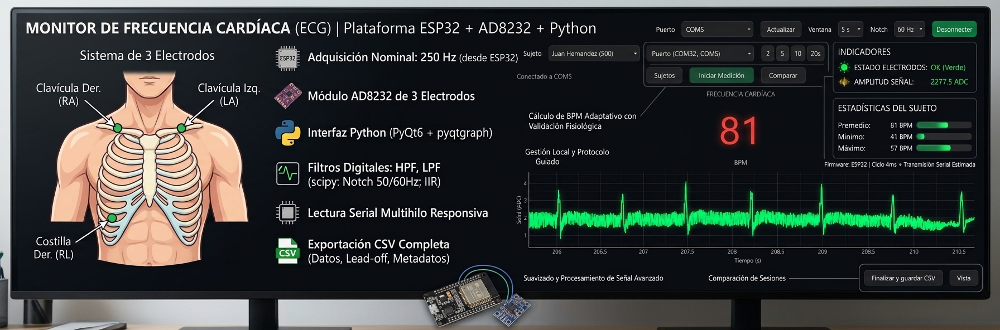
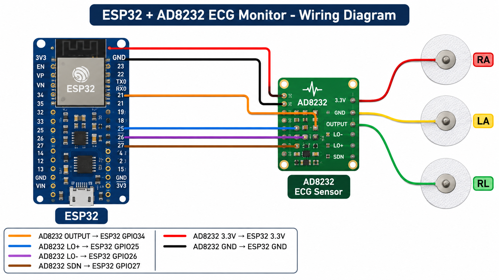
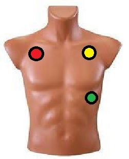
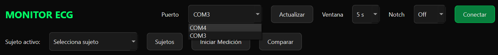
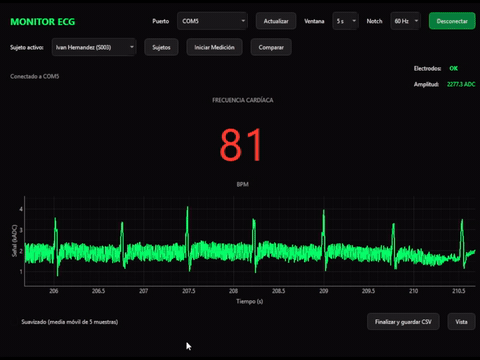
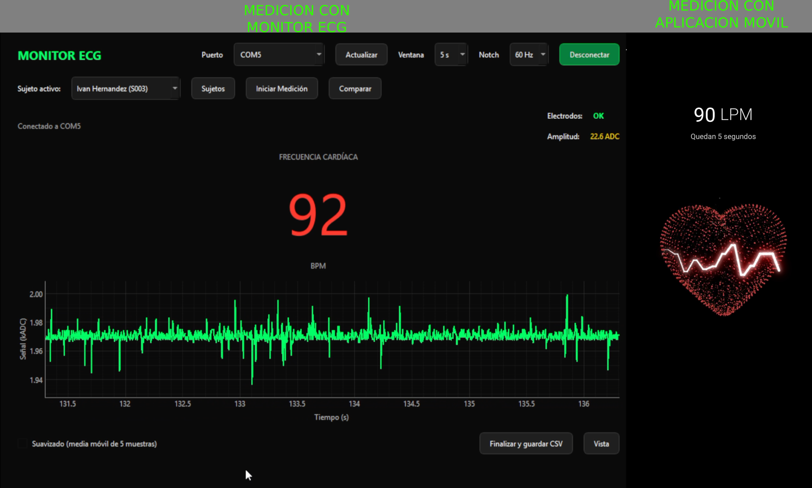
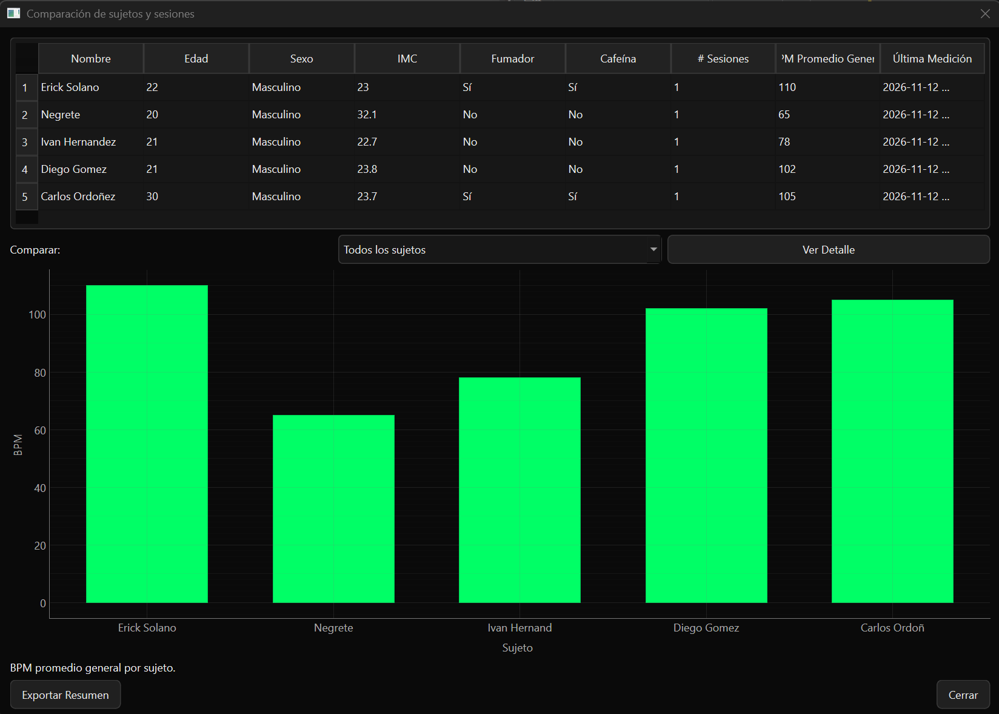
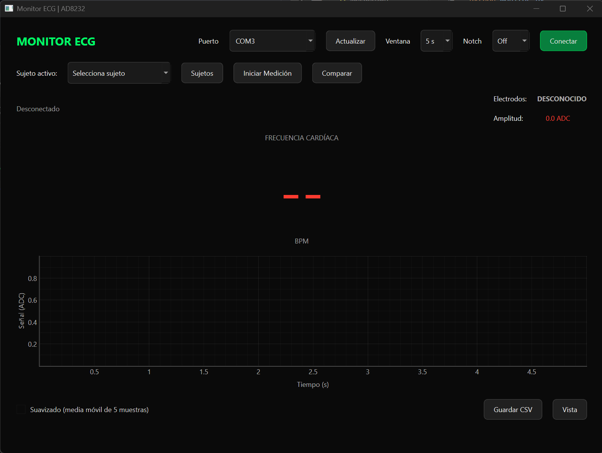

# Monitor ECG en Tiempo Real (ESP32 + AD8232 + Python)





Aplicación de escritorio para la adquisición, visualización y análisis de señales de electrocardiograma (ECG) en tiempo real. El proyecto integra un ESP32 con un módulo AD8232 y una interfaz Python. Está diseñado para fines educativos y de prototipado en mecatrónica; no es un dispositivo médico ni está destinado al diagnóstico.

## Características principales

- Adquisición nominal a **250 Hz** desde el ESP32.
- Interfaz gráfica moderna con tema oscuro, desarrollada con **PyQt6** y **pyqtgraph**.
- Eje X basado en tiempo real, con ventanas ajustables de **2, 5, 10 o 20 segundos**.
- Cálculo de BPM mediante un detector de picos adaptativo, mediana de intervalos y validación de rango fisiológico.
- Indicadores en vivo del estado de los electrodos (lead-off) y de la amplitud de la señal.
- Gestión local de sujetos y sesiones, con protocolo guiado de preparación.
- Comparación de sesiones y estadísticas de BPM por sujeto.
- Exportación a CSV de las muestras crudas, el estado de electrodos y los metadatos de la sesión.
- Filtros digitales pasa-altas y pasa-bajas para reducir la deriva de línea base y el ruido de alta frecuencia. SciPy habilita además la selección opcional de notch de 50/60 Hz; sin SciPy se usa el filtro IIR alternativo para el pasa-banda.
- Lectura serial en un hilo separado para mantener la interfaz receptiva.

> El firmware aplica una espera de 4 ms por ciclo. El tiempo de transmisión serial también influye en la frecuencia efectiva; la aplicación estima la frecuencia de muestreo a partir de las marcas de tiempo recibidas.

## Stack tecnológico

| Componente | Tecnología |
|---|---|
| Hardware | ESP32, módulo AD8232 y electrodos ECG |
| Firmware | C++ con Arduino IDE |
| Aplicación | Python 3.10+ |
| Interfaz y gráfica | PyQt6 y pyqtgraph |
| Comunicación serial | pyserial |
| Procesamiento numérico | NumPy y SciPy (opcional para notch y filtros SciPy) |

## Conexiones de hardware

| AD8232 | ESP32 |
|---|---|
| OUTPUT | GPIO34 |
| LO+ | GPIO25 |
| LO- | GPIO26 |
| SDN | GPIO27 |
| 3.3V | 3.3V |
| GND | GND |




Conecta los electrodos **RA** (ROJO:brazo derecho), **LA** (AMARILLO:brazo izquierdo) y **RL** (VERDE:Costilla inferior derecha o cadera derecha) siguiendo el diagrama y las indicaciones del fabricante del módulo. Verifica las conexiones y la alimentación antes de iniciar la adquisición.




## Instalación y ejecución

### Firmware ESP32

1. Instala Arduino IDE y el soporte de placas ESP32 de Espressif.
2. Conecta el AD8232 al ESP32 según la tabla anterior.
3. Abre [`ad8232_esp32.ino`](./ad8232_esp32.ino) en Arduino IDE.
4. Selecciona la placa ESP32 y el puerto correcto; carga el programa.
5. El firmware transmite las muestras como `valor:XXX` y el estado de electrodos como `leads:OK` o `leads:ERROR`, a **115200 baudios**.

### Aplicación Python

Desde esta carpeta, crea y activa un entorno virtual:

```bash
python -m venv .venv
```

En Windows:

```powershell
.venv\Scripts\activate
```

En macOS o Linux:

```bash
source .venv/bin/activate
```

Instala las dependencias declaradas en [`requirements.txt`](./requirements.txt):

```bash
pip install -r requirements.txt
```

Inicia la interfaz:

```bash
python monitor.py
```

El puerto inicial es **COM3**; puedes seleccionar otro puerto desde la ventana. Cierra el Monitor Serial de Arduino IDE antes de conectar la aplicación, ya que el puerto serial normalmente solo puede ser abierto por un programa a la vez.




## Guía de uso

1. Conecta el ESP32 por USB y verifica el puerto COM. Si aparece un puerto adicional de Bluetooth, selecciona el que indique **CP210x** o **USB Serial**.
2. Ejecuta la aplicación desde esta carpeta:

   ```bash
   python monitor.py
   ```

3. En la interfaz, selecciona el puerto serial y presiona **Conectar**. Confirma que aparezca **Electrodos: OK** y que **Amplitud** esté en verde y sea mayor de 50 ADC.
4. Registra a los participantes desde el botón **Sujetos**. Completa nombre, edad, sexo, peso, altura, condición de fumador y consumo reciente de cafeína; el IMC se calcula automáticamente.
5. Selecciona el sujeto activo y presiona **Iniciar Medición**. Completa el checklist del protocolo guiado y espera el timer de cinco minutos de reposo, o marca **Omitir timer de reposo**.
6. Observa la señal ECG en tiempo real. El eje X está expresado en segundos, la ventana puede ajustarse entre 2 y 20 segundos y el BPM se calcula mediante un detector de picos adaptativo.
7. Al terminar, presiona **Guardar CSV**. Se crea un archivo en `mediciones/` con los metadatos de la sesión y las muestras crudas.
8. Repite el procedimiento para otros sujetos o para una sesión **Después de ejercicio**.
9. Presiona **Comparar** para consultar la tabla resumen, una gráfica de barras de BPM por sujeto, una gráfica de líneas de las sesiones de un mismo sujeto y la opción **Exportar Resumen**.

> **Nota:** el puerto serial solo puede estar abierto por un programa a la vez; cierra el Monitor Serial de Arduino IDE antes de conectar la aplicación.

## Validación cruzada

Se realizó una prueba de precisión comparando el monitor ECG con el pulsómetro PPG de un teléfono inteligente que utiliza el sensor de huella:

| Dispositivo | BPM registrado |
|---|---:|
| Monitor ECG (AD8232 + ESP32) | 92 |
| Pulsómetro de smartphone (PPG) | 90 |

El error absoluto fue de **2 BPM** y el error relativo fue de aproximadamente **4%** respecto a la lectura del teléfono. Para un dispositivo de bajo costo (aproximadamente $200MXN en componentes), un error menor al 5% frente a un sensor PPG comercial es aceptable en este contexto educativo, considerando que los pulsómetros de smartphone suelen tener un margen típico de ±5–10%.



*La aplicación mostrando la señal ECG y el BPM en tiempo real.*



*Medición simultánea: el teléfono marcó 90 BPM y el monitor 92 BPM.*

## Sujetos y sesiones

Registra o edita sujetos desde **Sujetos**, selecciona el sujeto activo y usa **Iniciar Medición** para abrir el protocolo guiado. El protocolo permite completar la lista de preparación y esperar cinco minutos de reposo o marcar **Omitir timer de reposo**. Al finalizar, **Guardar CSV** cierra la sesión, almacena sus estadísticas y genera un archivo en `mediciones/`. El botón **Comparar** permite consultar resúmenes y gráficas por sujeto o por sesión.

Los sujetos y sus sesiones se conservan localmente en `sujetos.json`; cada CSV incluye los metadatos de la medición y sus muestras crudas. Estos archivos pueden contener datos personales y de salud: protégelos y compártelos solo con autorización.

## Análisis de datos

Estudio piloto con cinco sujetos masculinos de 20–30 años, medidos en reposo con una sesión por sujeto.

| # | Nombre | Edad | Sexo | IMC | Fumador | Cafeína | # Sesiones | BPM Promedio |
|---|---|---:|---|---:|---|---|---:|---:|
| 1 | Erick Solano | 22 | Masculino | 23.0 | Sí | Sí | 1 | 110 |
| 2 | Negrete | 20 | Masculino | 32.1 | No | No | 1 | 65 |
| 3 | Ivan Hernandez | 21 | Masculino | 22.7 | No | No | 1 | 78 |
| 4 | Diego Gomez | 21 | Masculino | 23.8 | No | No | 1 | 102 |
| 5 | Carlos Ordoñez | 30 | Masculino | 23.7 | Sí | Sí | 1 | 105 |

Estadística descriptiva de BPM: **promedio 92**, **mediana 102**, **mínimo 65**, **máximo 110** y **desviación estándar poblacional ≈ 17.4 BPM**.

Observaciones exploratorias:

- Los dos sujetos que reportaron consumo de cafeína y tabaco (Erick y Carlos) presentan los BPM más altos (110 y 105), un patrón consistente con el posible efecto simpaticomimético de ambas sustancias.
- El sujeto sin estimulantes y con IMC normal (Ivan) muestra el valor más bajo dentro del rango fisiológico esperado en reposo (78 BPM).
- El caso de Diego (102 BPM sin estimulantes) podría sugerir la influencia de factores no controlados, como ansiedad o efecto de bata blanca.
- El caso de Negrete (65 BPM con IMC de obesidad) es contraintuitivo y pone de manifiesto la necesidad de ampliar el tamaño muestral.



*BPM promedio por sujeto según la ventana de comparación de la aplicación.*

## Limitaciones del estudio

- Muestra reducida (**n=5**).
- Población homogénea: solo hombres de 20–30 años.
- Una sola sesión por sujeto.
- No se controlaron variables como horas de sueño, estrés, temperatura ambiental o ingesta de alimentos.
- Sensor de un solo canal (Derivación I), no apto para diagnóstico.
- Mediciones en reposo sin protocolo de esfuerzo.

## Trabajo futuro

- Ampliar la muestra e incluir población femenina.
- Realizar sesiones antes y después de ejercicio; la aplicación ya soporta ambos tipos de sesión.
- Incorporar análisis de variabilidad de la frecuencia cardíaca (HRV).
- Explorar detección básica de arritmias con fines educativos.
- Comparar las mediciones con equipo médico certificado.
- Añadir exportación a formatos estándar de investigación, como BIDS.
- Desarrollar una interfaz web con dashboards.

## Capturas de pantalla



Vista general de la aplicación con la señal ECG, frecuencia cardíaca, amplitud y estado de los electrodos.


## Costos de hardware

Costos aproximados de los componentes utilizados:

| Componente | Costo aproximado |
|---|---:|
| ESP32 | $110 a $150 MXN |
| Módulo AD8232 | $155 a $200 MXN |
| Electrodos reutilizables |  $116 MXN y $200 MXN por paquetes de 4 a 10 piezas |
| Cables y misceláneos | $20.00 MXN a $45.00 MXN |
| **Total aproximado** | **$400 a $590 MXN** |

El costo es muy inferior al de los monitores comerciales, lo que respalda el uso del proyecto con fines educativos.

## Nota ética

Los datos de salud son sensibles. Los participantes deben otorgar su consentimiento informado; los archivos `sujetos.json` y `mediciones/` no deben compartirse sin autorización. Este dispositivo no es un instrumento médico y no sustituye el criterio profesional.

## Autores y licencia

© 2026 Equipo de Sistemas Embebidos (Carlos Ordóñez, Jorge Negrete, Iván Hernandez, Karol Villagomez, Francisco Cadena, Diego Gomez).

**Todos los derechos reservados.**

Este repositorio y su contenido (código fuente, diagramas, documentación y simulaciones) han sido desarrollados exclusivamente con fines académicos y evaluativos para la materia **IME702 - Sistemas Embebidos/Modelado de sistemas**.

Queda estrictamente prohibida su reproducción, distribución, modificación o uso comercial sin la autorización expresa y por escrito de los autores. El acceso a este repositorio no otorga ninguna licencia sobre las obras contenidas en él.
