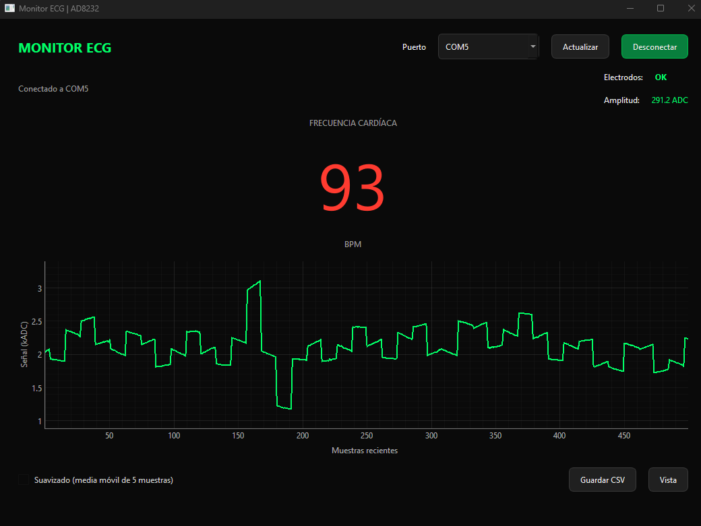
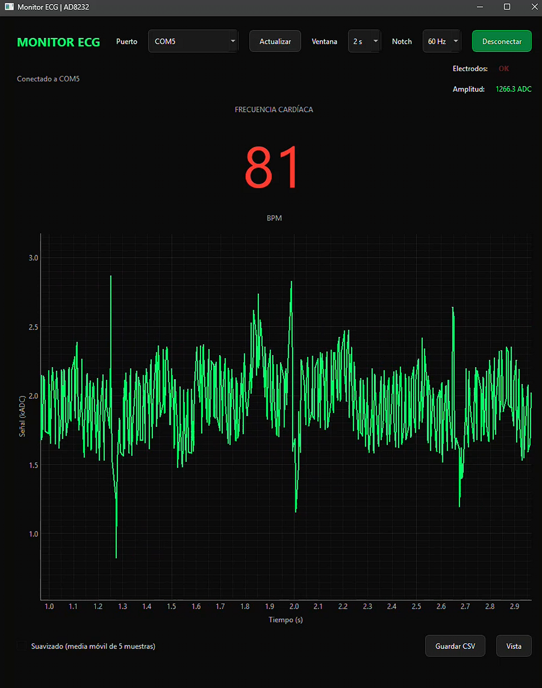

# Monitor ECG en Tiempo Real (ESP32 + AD8232 + Python)

Aplicación de escritorio para la adquisición, visualización y análisis de señales de electrocardiograma (ECG) en tiempo real. El proyecto integra un ESP32 con un módulo AD8232 y una interfaz Python. Está diseñado para fines educativos y de prototipado en mecatrónica; no es un dispositivo médico ni está destinado al diagnóstico.

## Características principales

- Adquisición nominal a **250 Hz** desde el ESP32.
- Interfaz gráfica moderna con tema oscuro, desarrollada con **PyQt6** y **pyqtgraph**.
- Eje X basado en tiempo real, con ventanas ajustables de **2, 5, 10 o 20 segundos**.
- Cálculo de BPM mediante un detector de picos adaptativo, mediana de intervalos y validación de rango fisiológico.
- Indicadores en vivo del estado de los electrodos (lead-off) y de la amplitud de la señal.
- Exportación de muestras ADC crudas y estado de electrodos a CSV.
- Filtros digitales pasa-altas y pasa-bajas para reducir la deriva de línea base y el ruido de alta frecuencia. SciPy habilita además la selección opcional de notch de 50/60 Hz; sin SciPy se usa el filtro IIR alternativo para el pasa-banda.
- Lectura serial en un hilo separado para mantener la interfaz receptiva.

> El firmware aplica una espera de 4 ms por ciclo. El tiempo de transmisión serial también influye en la frecuencia efectiva; la aplicación estima la frecuencia de muestreo a partir de las marcas de tiempo recibidas.

## Stack tecnológico

| Componente | Tecnología |
|---|---|
| Hardware | ESP32, módulo AD8232 y electrodos ECG |
| Firmware | C++ con Arduino IDE |
| Aplicación | Python 3.10+ |
| Interfaz y gráfica | PyQt6 y pyqtgraph |
| Comunicación serial | pyserial |
| Procesamiento numérico | NumPy y SciPy (opcional para notch y filtros SciPy) |

## Conexiones de hardware

| AD8232 | ESP32 |
|---|---|
| OUTPUT | GPIO34 |
| LO+ | GPIO25 |
| LO- | GPIO26 |
| SDN | GPIO27 |
| 3.3V | 3.3V |
| GND | GND |

Conecta los electrodos **RA** (brazo derecho), **LA** (brazo izquierdo) y **RL** (pierna derecha) siguiendo el diagrama y las indicaciones del fabricante del módulo. Verifica las conexiones y la alimentación antes de iniciar la adquisición.

## Instalación y ejecución

### Firmware ESP32

1. Instala Arduino IDE y el soporte de placas ESP32 de Espressif.
2. Conecta el AD8232 al ESP32 según la tabla anterior.
3. Abre [`ad8232_esp32.ino`](./ad8232_esp32.ino) en Arduino IDE.
4. Selecciona la placa ESP32 y el puerto correcto; carga el programa.
5. El firmware transmite las muestras como `valor:XXX` y el estado de electrodos como `leads:OK` o `leads:ERROR`, a **115200 baudios**.

### Aplicación Python

Desde esta carpeta, crea y activa un entorno virtual:

```bash
python -m venv .venv
```

En Windows:

```powershell
.venv\Scripts\activate
```

En macOS o Linux:

```bash
source .venv/bin/activate
```

Instala las dependencias declaradas en [`requirements.txt`](./requirements.txt):

```bash
pip install -r requirements.txt
```

Inicia la interfaz:

```bash
python monitor.py
```

El puerto inicial es **COM3**; puedes seleccionar otro puerto desde la ventana. Cierra el Monitor Serial de Arduino IDE antes de conectar la aplicación, ya que el puerto serial normalmente solo puede ser abierto por un programa a la vez.

## Capturas de pantalla



Vista general de la aplicación con la señal ECG, frecuencia cardíaca, amplitud y estado de los electrodos.



Diagrama de cableado entre el módulo AD8232 y los pines del ESP32.

